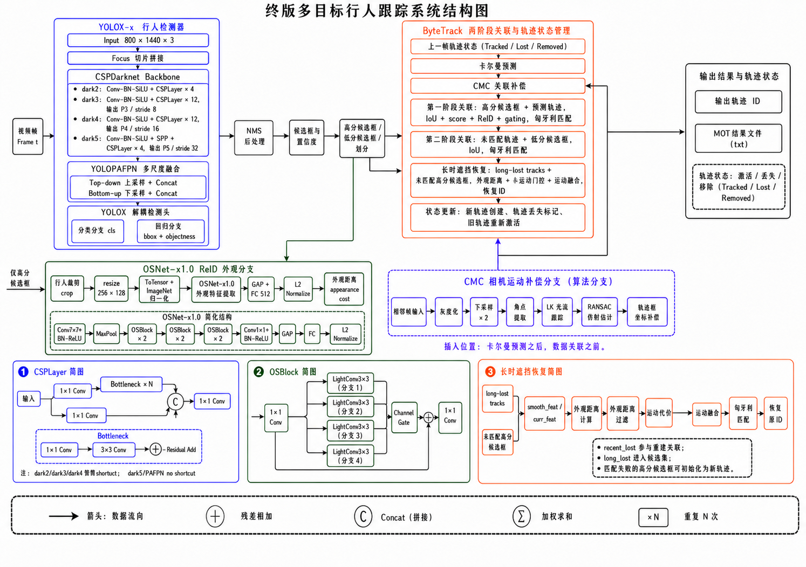
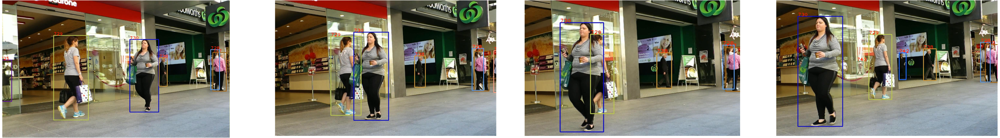
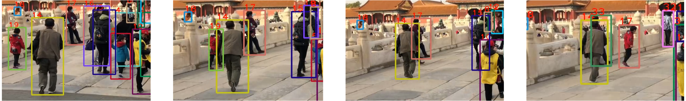

# 方法与代码对应关系

输入视频帧先经 YOLOX-x 检测，检测框经 NMS 后交给 ByteTrack。高置信度检测参与第一阶段关联，低置信度检测用于补充未匹配轨迹；外观特征和相机运动估计在此基础上辅助匹配与轨迹恢复。

| 模块 | 主要代码 | 作用 |
| --- | --- | --- |
| 演示入口 | `tools/demo_track.py` | 视频读写、检测器初始化、跟踪与可视化 |
| 评估入口 | `tools/track.py` | 数据加载、序列跟踪、指标和提交文件 |
| 检测适配 | `yolox/utils/detector.py` | 整理检测结果、加载 YOLOX 权重 |
| 跟踪核心 | `yolox/tracker/byte_tracker.py` | 两阶段关联、状态更新、长期丢失恢复 |
| 外观特征 | `yolox/tracker/reid_extractor.py` | 裁剪行人、OSNet 推理、特征归一化 |
| 匹配代价 | `yolox/tracker/matching.py` | IoU、外观距离、运动门控与匹配求解 |
| 运动预测 | `yolox/tracker/kalman_filter.py` | 轨迹状态预测和门控 |
| 相机补偿 | `yolox/tracker/gmc.py` | LK 光流、RANSAC 仿射估计和坐标补偿 |

## 终版关联过程

1. 预测已有轨迹位置，启用 CMC 时补偿由相机运动造成的位置变化。
2. 高分检测与可参与常规关联的轨迹匹配，ReID 提供外观信息，运动和重叠条件限制候选范围。
3. 低分检测补充关联仍未匹配的轨迹，保留原版 ByteTrack 的基本处理方式。
4. 处理尚未确认的新轨迹，再对剩余高分检测进行长时遮挡恢复。
5. 长期丢失轨迹经过外观阈值和运动条件筛选后尝试恢复，成功时保留原 ID，未匹配检测可初始化新轨迹。
6. 更新激活、丢失和移除状态，输出目标框、ID 和置信度。

## 常用参数

| JSON 参数 | 终版示例值 | 含义 |
| --- | ---: | --- |
| `track_thresh` | 0.55 | 常规高分检测阈值 |
| `match_thresh` | 0.78 | 第一阶段匹配阈值 |
| `with_reid` | true | 开启外观特征辅助 |
| `appearance_thresh` | 0.22 | 常规外观距离阈值 |
| `reid_weight` | 0.4 | 常规外观关联参数 |
| `with_long_recovery` | true | 开启长期丢失轨迹恢复 |
| `long_track_buffer` | 90 | 长时恢复分支的轨迹保留参数 |
| `recent_lost_window` | 24 | 短期丢失窗口 |
| `lost_appearance_thresh` | 0.15 | 长期恢复使用的更严格外观阈值 |
| `long_match_thresh` | 0.3 | 长期恢复匹配阈值 |
| `with_cmc` | true | 开启相机运动补偿 |
| `cmc_downscale` | 2 | 运动估计下采样参数 |

阈值应结合检测器、视频尺度与场景验证，现有数值不表示通用最优设置。轨迹保留时间还受输入帧率和实现中的换算影响，实际逻辑以跟踪核心为准。

## 定性案例与局限

该案例展示了近距离交叉时的身份保持情况。外观特征能够补充框重叠信息，但相似衣着、目标较小和严重遮挡仍会影响特征质量。

长时恢复可能把相似外观目标错误关联到历史轨迹，CMC 也会受到光照、快速运动和可用背景特征不足的影响。演示、训练集评估和独立测试集结果需要分别记录，不能以少量展示图片代替完整评估。
